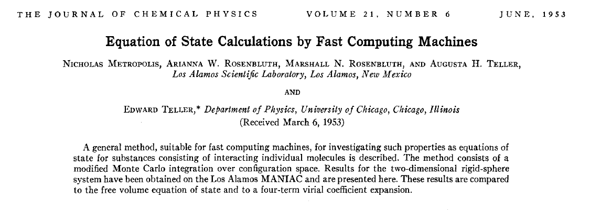

```{r setup, include = FALSE}
knitr::opts_chunk$set(cache = FALSE, 
                      echo = TRUE, 
                      message = FALSE, 
                      warning = FALSE,
                      fig.height=6, 
                      fig.width = 1.777777*6,
                      tidy = FALSE, 
                      comment = NA, 
                      highlight = TRUE, 
                      prompt = FALSE, 
                      crop = TRUE,
                      comment = "#>",
                      collapse = TRUE)
knitr::opts_knit$set(width = 60)
library(tidyverse)
library(reshape2)
theme_set(theme_light(base_size = 16))
make_latex_decorator <- function(output, otherwise) {
  function() {
      if (knitr:::is_latex_output()) output else otherwise
  }
}
insert_pause <- make_latex_decorator(". . .", "\n")
insert_slide_break <- make_latex_decorator("----", "\n")
insert_inc_bullet <- make_latex_decorator("> *", "*")
insert_html_math <- make_latex_decorator("", "$$")
```


# Get posteriors with Markov chains Monte Carlo (MCMC) methods

## Back to the Bayes' theorem	

* Bayes inference is easy! Well, not so easy in real-life applications.

`r insert_pause()`

* The issue is in ${\Pr(\theta \mid \text{data})} = \displaystyle{\frac{{\Pr(\text{data} \mid \theta)} \; {\Pr(\theta)}}{\color{orange}{\Pr(\text{data})}}}$

`r insert_pause()`

* $\color{orange}{\Pr(\text{data}) = \int{L(\text{data} \mid \theta)\Pr(\theta) d\theta}}$ is a $N$-dimensional integral if $\theta = \theta_1, \ldots, \theta_N$ 

`r insert_pause()`

* Difficult, if not impossible to calculate! 

## Brute force approach via numerical integration

* Coypus data
```{r}
y <- 19 # nb of success
n <- 57 # nb of attempts
```

* Likelihood $\text{Binomial}(57, \theta)$

* Prior $\text{Beta}(a = 1, b = 1)$

## Beta prior

```{r}
a <- 1; b <- 1; p <- seq(0,1,.002)
plot(p, dbeta(p,a,b), type='l', lwd=3)
```

## Apply Bayes theorem

* Likelihood times the prior: $\Pr(\text{data} \mid \theta) \; \Pr(\theta)$
```{r}
numerator <- function(p) dbinom(y,n,p)*dbeta(p,a,b)
```

* Averaged likelihood: $\Pr(\text{data}) = \int{L(\theta \mid \text{data}) \; \Pr(\theta) d\theta}$
```{r}
denominator <- integrate(numerator,0,1)$value
```

## Posterior inference via numerical integration

```{r}
plot(p, numerator(p)/denominator,type="l", lwd=3, col="green", lty=2)
```

## Superimpose explicit posterior distribution (Beta formula) 

```{r eval = FALSE}
lines(p, dbeta(p,y+a,n-y+b), col='darkred', lwd=3)
```

```{r echo = FALSE}
plot(p, numerator(p)/denominator,type="l", lwd=3, col="green", lty=2)
lines(p, dbeta(p,y+a,n-y+b), col='darkred', lwd=3)
```

## And the prior

```{r eval = FALSE}
lines(p, dbeta(p,a,b), col='darkblue', lwd=3)
```

```{r echo = FALSE}
plot(p, numerator(p)/denominator,type="l", lwd=3, col="green", lty=2)
lines(p, dbeta(p,y+a,n-y+b), col='darkred', lwd=3)
lines(p, dbeta(p,a,b), col='darkblue', lwd=3)
```

## What if multiple parameters, like in a simple linear regression?

* Example of a linear regression with parameters $\alpha$, $\beta$ and $\sigma$ to be estimated. 

`r insert_pause()`

* Bayes' theorem says:

$$ P(\alpha, \beta, \sigma \mid \text{data}) = \frac{ P(\text{data} \mid \alpha, \beta, \sigma) \, P(\alpha, \beta, \sigma)}{\iiint \, P(\text{data} \mid \alpha, \beta, \sigma) \, P(\alpha, \beta, \sigma) \,d\alpha \,d\beta \,d\sigma} $$

`r insert_pause()`

* Do we really wish to calculate a 3D integral?

## Bayesian computation

* In the early 1990s, statisticians rediscovered work from the 1950's in physics.

```{r, out.width = '9cm',out.height='3cm',fig.align='center',echo=FALSE}
   
```

`r insert_pause()`

* Use stochastic simulation to draw samples from posterior distributions.

`r insert_pause()`

* Avoid explicit calculation of integrals in Bayes formula.

`r insert_pause()`

* Instead, approximate posterior to arbitrary degree of precision by drawing large sample.

`r insert_pause()`

* Markov chain Monte Carlo = MCMC; boost to Bayesian statistics!

## MANIAC

```{r, out.width = '11cm',out.height='7cm',fig.align='center',echo=FALSE}
   
```

## Why are MCMC methods so useful?

`r insert_inc_bullet()` MCMC: stochastic algorithm to produce sequence of dependent random numbers (from Markov chain).

`r insert_inc_bullet()` Converge to equilibrium (aka stationary) distribution.

`r insert_inc_bullet()` Equilibrium distribution is the desired posterior distribution!

`r insert_inc_bullet()` Several ways of constructing these chains: e.g., Metropolis-Hastings, Gibbs sampler, Metropolis-within-Gibbs.

`r insert_inc_bullet()` How to implement them in practice?!

## The Metropolis algorithm

`r insert_inc_bullet()` Let's go back to the coypus example and survival estimation.

`r insert_inc_bullet()` We illustrate sampling from the posterior distribution of winter survival. 

`r insert_inc_bullet()` We write functions in `R` for the likelihood, the prior and the posterior.

`r insert_slide_break()`

```{r}
# coypus data, 19 "success" out of 57 "attempts"
survived <- 19
released <- 57

# log-likelihood function
loglikelihood <- function(x, p){
  dbinom(x = x, size = released, prob = p, log = TRUE)
}

# prior density
logprior <- function(p){
  dunif(x = p, min = 0, max = 1, log = TRUE)
}
```

`r insert_slide_break()`

```{r}
# posterior density function (log scale)
posterior <- function(x, p){
  loglikelihood(x, p) + logprior(p) # - log(Pr(data))
}
```

`r insert_slide_break()`

To simulate from this posterior distribution, we use the **Metropolis algorithm**:

`r insert_pause()`

1. We start at any possible value of the parameter to be estimated. 

`r insert_pause()`

2. To decide where to visit next, we propose to move away from the current value of the parameter. We add to this current value some random value from say a normal distribution with some variance. We call this the **candidate** location.

`r insert_pause()`

3. We compute the ratio of the probabilities at the candidate and current locations $R = posterior(candidate)/posterior(current)$. This is where the magic of MCMC happens, in that $\Pr(data)$ (the denominator of the Bayes theorem) cancels out when we compute $R$. 

`r insert_pause()`

4. We spin a continuous spinner that lands anywhere from 0 to 1 –- call the random spin $X$. If $X$ is smaller than $R$, we move to the candidate location, otherwise we remain at the current location.

`r insert_pause()`

5. We repeat 2-4 a number of times called **steps** (many steps).

`r insert_slide_break()`

```{r}
# propose candidate value
move <- function(x, away = .2){ 
  logitx <- log(x / (1 - x))
  logit_candidate <- logitx + rnorm(1, 0, away)
  candidate <- plogis(logit_candidate)
  return(candidate)
}

# set up the scene
steps <- 100
theta.post <- rep(NA, steps)
set.seed(1234)
```

`r insert_slide_break()`

```{r}
# pick starting value (step 1)
inits <- 0.5
theta.post[1] <- inits
```

`r insert_slide_break()`

```{r}
for (t in 2:steps){ # repeat steps 2-4 (step 5)
  
  # propose candidate value for prob of success (step 2)
  theta_star <- move(theta.post[t-1])
  
  # calculate ratio R (step 3)
  pstar <- posterior(survived, p = theta_star)  
  pprev <- posterior(survived, p = theta.post[t-1])
  logR <- pstar - pprev
  R <- exp(logR)
  
  # decide to accept candidate value or to keep current value (step 4)
  accept <- rbinom(1, 1, prob = min(R, 1))
  theta.post[t] <- ifelse(accept == 1, theta_star, theta.post[t-1])
}
```

`r insert_slide_break()`

Starting at the value $0.5$ and running the algorithm for $100$ iterations.

```{r}
head(theta.post)
tail(theta.post)
```

`r insert_slide_break()`

```{r echo = FALSE}
plot(x = 1:steps, 
     y = theta.post, 
     type = "l", 
     xlab = "iterations", 
     ylab = "values from posterior distribution",
     lwd = 2,
     ylim = c(0.1, 0.6))
```


`r insert_slide_break()`

```{r echo = FALSE}
plot(x = 1:steps, 
     y = theta.post, 
     type = "l", 
     xlab = "iterations", 
     ylab = "values from posterior distribution",
     lwd = 2,
     ylim = c(0.1,0.6))

# pick starting value (step 1)
inits <- 0.2
theta.post2 <- rep(NA, steps)
theta.post2[1] <- inits

for (t in 2:steps){ # repeat steps 2-4 (step 5)
  # propose candidate value for prob of success (step 2)
  theta_star <- move(theta.post2[t-1])
  # calculate ratio R (step 3)
  pstar <- posterior(survived, p = theta_star)  
  pprev <- posterior(survived, p = theta.post[t-1])
  logR <- pstar - pprev
  R <- exp(logR)
  
  # decide to accept candidate value or to keep current value (step 4)
  accept <- rbinom(1, 1, prob = min(R, 1))
  theta.post2[t] <- ifelse(accept == 1, theta_star, theta.post2[t-1])
}
lines(x = 1:steps, 
     y = theta.post2, 
     lwd = 2,
     col = "blue")

```


`r insert_slide_break()`

```{r echo = FALSE}
plot(x = 1:steps, 
     y = theta.post, 
     type = "l", 
     xlab = "iterations", 
     ylab = "values from posterior distribution",
     lwd = 2,
     ylim = c(0.1,0.6))

lines(x = 1:steps, 
     y = theta.post2, 
     lwd = 2,
     col = "blue")
```


`r insert_slide_break()`

```{r echo = FALSE}
# set up the scene
steps <- 5000
theta.post <- rep(NA, steps)
set.seed(1234)

# pick starting value (step 1)
inits <- 0.5
theta.post[1] <- inits

for (t in 2:steps){ # repeat steps 2-4 (step 5)
  
  # propose candidate value for prob of success (step 2)
  theta_star <- move(theta.post[t-1])
  
  # calculate ratio R (step 3)
  pstar <- posterior(survived, p = theta_star)  
  pprev <- posterior(survived, p = theta.post[t-1])
  logR <- pstar - pprev
  R <- exp(logR)
  
  # decide to accept candidate value or to keep current value (step 4)
  accept <- rbinom(1, 1, prob = min(R, 1))
  theta.post[t] <- ifelse(accept == 1, theta_star, theta.post[t-1])
}

plot(x = 1:steps, 
     y = theta.post, 
     type = "l", 
     xlab = "iterations", 
     ylab = "values from posterior distribution",
     lwd = 2,
     ylim = c(0.1, 0.6))

abline(h = mean(theta.post), col = "blue", lwd = 2)
text(3700, 0.57, "posterior mean", col = "blue", adj = c(-.1, -.1))
abline(h = 19/57, col = "red", lwd = 2)
text(3700, 0.55, "max lik estimate", col = "red", adj = c(-.1, -.1))
```

## Animating the Metropolis algorithm - 1D example

[\alert{https://gist.github.com/oliviergimenez/5ee33af9c8d947b72a39ed1764040bf3}](https://gist.github.com/oliviergimenez/5ee33af9c8d947b72a39ed1764040bf3)


## Animating the Metropolis algorithm - 2D example

[\alert{https://mbjoseph.github.io/posts/2018-12-25-animating-the-metropolis-algorithm/}](https://mbjoseph.github.io/posts/2018-12-25-animating-the-metropolis-algorithm/)

## The Markov-chain Monte Carlo Interactive Gallery

[\alert{https://chi-feng.github.io/mcmc-demo/}](https://chi-feng.github.io/mcmc-demo/)


# Assessing convergence

## Principle

When implementing MCMC, we need to determine how long it takes for our Markov chain to converge to the target distribution, and the number of iterations we need after achieving convergence to get reasonable Monte Carlo estimates of numerical summaries (posterior means and credible intervals).

# Burn-in

## Burn-in
  
+ In practice, we discard observations from the start of the Markov chain and just use observations from the chain once it has converged. The initial observations that we discard are usually referred to as the *burn-in*. 

+ The simplest method to determine the length of the burn-in period is to look at trace plots. Going back to our example, let's have a look to a trace plot of a chain that starts at value 0.99. 

```{r echo = FALSE}
metropolis <- function(steps = 100, inits = 0.5, away = 1){
  
  # pre-alloc memory
  theta.post <- rep(NA, steps)
  
  # start
  theta.post[1] <- inits
  
  for (t in 2:steps){
    
    # propose candidate value for prob of success
    theta_star <- move(theta.post[t-1], away = away)
    
    # calculate ratio R
    pstar <- posterior(survived, p = theta_star)  
    pprev <- posterior(survived, p = theta.post[t-1])
    logR <- pstar - pprev
    R <- exp(logR)
    
    # accept candidate value or keep current value (step 4)
    X <- runif(1, 0, 1) # spin continuous spinner
    if (X < R){
      theta.post[t] <- theta_star
    }
    else{
      theta.post[t] <- theta.post[t-1]
    }
  }
  theta.post
}
```

## Burn-in

```{r echo = FALSE}
# set up the scene
steps <- 1000
theta.post <- metropolis(steps = steps, inits = 0.99)
df <- data.frame(x = 1:steps, y = theta.post)
df %>%
  ggplot() +
  geom_line(aes(x = x, y = y), size = 1.2, color = wesanderson::wes_palettes$Zissou1[1]) + 
  labs(x = "iterations", y = "survival") + 
  theme_light(base_size = 14) + 
  annotate("rect", 
           xmin = 0, 
           xmax = 100, 
           ymin = 0.1, 
           ymax = 1, 
           alpha = .3) +
  scale_y_continuous(expand = c(0,0))
```

<!-- The chain starts at value 0.99 and rapidly stabilises, with values bouncing back and forth around 0.3 from the 100th iteration onwards. You may choose the shaded area as the burn-in, and discard the first 100th values. -->

<!-- We see from the trace plot below that we need at least 100 iterations to achieve convergence toward an average survival around 0.3. It is always better to be conservative when specifying the length of the burn-in period, and in this example, we would use 250 or even 500 iterations as a burn-in. The length of the burn-in period can be determined by performing preliminary MCMC short runs.  -->

## Burn-in

+ Inspecting the trace plot for a single run of the Markov chain is useful. 

+ However, we usually run the Markov chain several times, starting from different over-dispersed points, to check that all runs achieve the same stationary distribution. 

+ This approach is formalised by using the Brooks-Gelman-Rubin (BGR) statistic $\hat{R}$ which measures the ratio of the total variability combining multiple chains (between-chain plus within-chain) to the within-chain variability. 

+ The BGR statistic asks whether there is a chain effect, and is very much alike the $F$ test in an analysis of variance. 

+ Values below 1.1 indicate likely convergence.

## Burn-in

```{r, echo = FALSE, cache = TRUE}
simul.bgr <- function(steps, inits){
  
  nb.replicates <- length(inits)
  theta.post <- matrix(NA, nrow = nb.replicates, ncol = steps)
  for (i in 1:nb.replicates){
    theta.post[i,1:steps] <- metropolis(steps = steps, inits = inits[i])
  }
  
  df <- data.frame(x = rep(1:steps, nb.replicates), 
                   y = c(t(theta.post)), 
                   chain = paste0("chain ",gl(nb.replicates, steps))) %>%
    filter(x > round(steps/2)) # apply burnin (half number of iterations)

  # compute BGR (R-hat)
  num <- quantile(df$y, probs = c(20/100, 80/100))[2] - quantile(df$y, probs = c(20/100, 80/100))[1]
  den <- df %>%
    group_by(chain) %>%
    summarise(ci = quantile(y, probs = c(20/100, 80/100))) %>%
    mutate(diff = ci - lag(ci, default = ci[1])) %>%
    filter(diff != 0) %>%
    pull(diff) %>%
    mean()
  
  bgr <- round(num / den, 3)
  return(bgr)
}

set.seed(1234)
steps <- seq(100, 5000, 100)
bgr <- rep(NA, length(steps))
for (i in 1:length(steps)){
  bgr[i] <- simul.bgr(steps = steps[i], inits = c(0.2, 0.8))
}
df <- data.frame(iterations = steps, bgr = bgr)
```

Back to our example, we run two Markov chains with starting values 0.2 and 0.8 using 100 up to 5000 iterations, and calculate the BGR statistic using half the number of iterations as the length of the burn-in.

## Burn-in

```{r bgr, echo=FALSE}
df %>%
  ggplot() + 
  geom_line(aes(x = iterations, y = bgr), size = 1.2) +
  labs(y = "BGR statistic")
```

<!-- We get a value of the BGR statistic near 1 by up to 2000 iterations, which suggests that with 2000 iterations as a burn-in, there is no evidence of a lack of convergence. -->

<!-- It is important to bear in mind that a value near 1 for the BGR statistic is only a necessary *but not sufficient* condition for convergence. In other words, this diagnostic cannot tell you for sure that the Markov chain has achieved convergence, only that it has not. -->

# Chain length
  
## Chain length

+ How long of a chain is needed to produce reliable parameter estimates? 

+ To answer this question, you need to keep in mind that successive steps in a Markov chain are not independent -- this is usually referred to as *autocorrelation*. 

+ Ideally, we would like to keep autocorrelation as low as possible. 

+ Here again, trace plots are useful to diagnose issues with autocorrelation. 

+ Let's get back to our survival example. 

## Chain length

```{r, echo = FALSE}
# inspired from https://bookdown.org/content/3686/markov-chain-monte-carlo.html

n_steps <- 10000

d <-
  tibble(away = c(0.1, 1, 10)) %>% 
  mutate(accepted_traj = map(away, metropolis, steps = n_steps, inits = 0.1)) %>% 
  unnest(accepted_traj)

d <-
  d %>% 
  mutate(proposal_sd = str_c("Proposal SD = ", away),
         iter        = rep(1:n_steps, times = 3))

trace <- d %>% 
  ggplot(aes(y = accepted_traj, x = iter)) +
  geom_path(size = 1/4, color = "steelblue") +
  geom_point(size = 1/2, alpha = 1/2, color = "steelblue") +
  scale_y_continuous("survival", breaks = 0:5 * 0.1, limits = c(0.15, 0.5)) +
  scale_x_continuous("iterations", 
                     breaks = seq(n_steps-n_steps*10/100,n_steps,by = 600), 
                     limits = c(n_steps-n_steps*10/100, n_steps)) +
  facet_wrap(~proposal_sd, ncol = 3) +
  theme_light(base_size = 14)

trace
```

## Chain length

<!-- + Small and big moves in the left and right panels provide high correlations between successive observations of the Markov chain, whereas a standard deviation of 1 in the center panel allows efficient exploration of the parameter space.  -->

+ The movement around the parameter space is referred to as *mixing*. 

+ Mixing is bad when the chain makes small and big moves, and good otherwise. 

## Chain length

+ In addition to trace plots, autocorrelation function (ACF) plots are a convenient way of displaying the strength of autocorrelation in a given sample values. 

+ ACF plots provide the autocorrelation between successively sampled values separated by an increasing number of iterations, or *lag*. 

+ We obtain the autocorrelation function plots for different values of the standard deviation of the proposal distribution with the R `forecast::ggAcf()` function. 

## Chain length

```{r echo = FALSE}
library(forecast)
plot1 <- ggAcf(x = d$accepted_traj[d$proposal_sd=="Proposal SD = 0.1"]) + ggtitle("Proposal SD = 0.1")
plot2 <- ggAcf(x = d$accepted_traj[d$proposal_sd=="Proposal SD = 1"]) + ggtitle("Proposal SD = 1")
plot3 <- ggAcf(x = d$accepted_traj[d$proposal_sd=="Proposal SD = 10"]) + ggtitle("Proposal SD = 10")

library(patchwork)
(plot1 + plot2 + plot3)
```

## Chain length

<!-- + In the left and right panels, autocorrelation is strong, decreases slowly with increasing lag and mixing is bad. In the center panel, autocorrelation is weak, decreases rapidly with increasing lag and mixing is good. -->

+ Autocorrelation is not necessarily a big issue. Strongly correlated observations just require large sample sizes and therefore longer simulations. But how many iterations exactly? 

+ The effective sample size (`n.eff`) measures chain length while taking into account chain autocorrelation. 
+ You should check the `n.eff` of every parameter of interest, and of any interesting parameter combinations. 

+ In general, we need $\text{n.eff} \geq 100$ independent steps to get reasonable Monte Carlo estimates of model parameters. 

+ In the animal survival example, `n.eff` can be calculated with the R `coda::effectiveSize()` function.

## Chain length

```{r neff, echo = FALSE}
neff1 <- coda::effectiveSize(d$accepted_traj[d$proposal_sd=="Proposal SD = 0.1"])
neff2 <- coda::effectiveSize(d$accepted_traj[d$proposal_sd=="Proposal SD = 1"])
neff3 <- coda::effectiveSize(d$accepted_traj[d$proposal_sd=="Proposal SD = 10"])
df <- tibble("Proposal SD" = c(0.1, 1, 10),
             "n.eff" = round(c(neff1, neff2, neff3)))
df
```

<!-- ## Chain length -->

<!-- As expected, `n.eff` is less than the number of MCMC iterations because of autocorrelation. Only when the standard deviation of the proposal distribution is 1 is the mixing good and we get a satisfying effective sample size.  -->

# What if you have issues of convergence?
  
## What if you have issues of convergence?

+ When mixing is bad and effective sample size is small, you may just need to increase burn-in and/or sample more. 

+ Using more informative priors might also make Markov chains converge faster by helping your MCMC sampler (e.g. the Metropolis algorithm) navigating more efficiently the parameter space. 

+ In the same spirit, picking better initial values for starting the chain does not harm. For doing that, a strategy consists in using estimates from a simpler model for which your MCMC chains do converge. 

## What if you have issues of convergence?

+ If convergence issues persist, often there is a problem with your model. 

+ A bug in the code? A typo somewhere? A mistake in your maths? 

+ As often when coding is involved, the issue can be identified by removing complexities, and start with a simpler model until you find what the problem is. 

## What if you have issues of convergence?

+ A general advice is to see your model as a data generating tool in the first place, simulate data from it using some realistic values for the parameters, and try to recover these parameter values by fitting the model to the simulated data. 

+ Simulating from a model will help you understanding how it works, what it does not do, and the data you need to get reasonable parameter estimates. 

<!-- We will see other strategies to improve convergence in the next chapters. Cross reference relevant chapters. Option 1. Change your sampler. Option 2. Reparameterize (standardize covariates, plus non-centering: $\alpha \sim N(0,\sigma)$ becomes $\alpha = z \sigma$ with $z \sim N(0,1)$). -->

# Summary

## Summary

+ With the Bayes' theorem, you update your beliefs (prior) with new data (likelihood) to get posterior beliefs (posterior): posterior $\propto$ likelihood $\times$ prior.

+ The idea of Markov chain Monte Carlo (MCMC) is to simulate values from a Markov chain which has a stationary distribution equal to the posterior distribution you're after. 

+ In practice, you run a Markov chain multiple times starting from over-dispersed initial values. 

+ You discard iterations in an initial burn-in phase and achieve convergence when all chains reach the same regime. 

+ From there, you run the chains long enough and proceed with calculating Monte Carlo estimates of numerical summaries (e.g. posterior means and credible intervals) for parameters.
