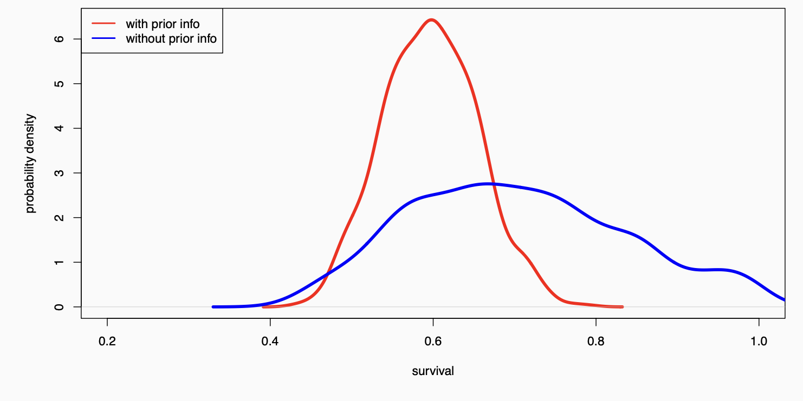
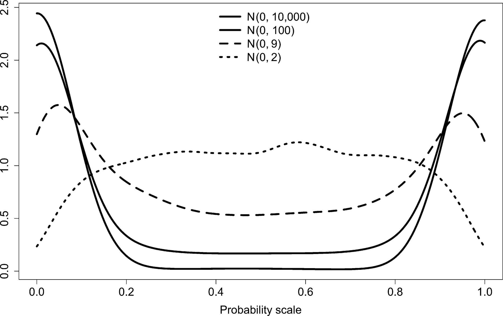

```{r setup, include = FALSE}
knitr::opts_chunk$set(cache = FALSE, 
                      echo = TRUE, 
                      message = FALSE, 
                      warning = FALSE,
                      fig.height=6, 
                      fig.width = 1.777777*6,
                      tidy = FALSE, 
                      comment = NA, 
                      highlight = TRUE, 
                      prompt = FALSE, 
                      crop = TRUE,
                      comment = "#>",
                      collapse = TRUE)
knitr::opts_knit$set(width = 60)
library(tidyverse)
library(reshape2)
theme_set(theme_light(base_size = 16))
make_latex_decorator <- function(output, otherwise) {
  function() {
      if (knitr:::is_latex_output()) output else otherwise
  }
}
insert_pause <- make_latex_decorator(". . .", "\n")
insert_slide_break <- make_latex_decorator("----", "\n")
insert_inc_bullet <- make_latex_decorator("> *", "*")
insert_html_math <- make_latex_decorator("", "$$")
```

# Influence of the prior: Back to our guiding example

## Prior $Beta(0.5,0.5)$ and posterior survival $Beta(19.5,38.5)$
```{r echo=FALSE}
x <- seq(0, 1, length=200)
# distribution a posteriori beta
plot(x,dbeta(x, .5+19,.5+57-19),type='l',xlab='',ylab='',main='',lwd=3,col='red')
# distribution a priori uniforme
points(x,dbeta(x, .5, .5),type='l',lwd=3)
```

## Prior $Beta(2,2)$ and posterior survival $Beta(21,40)$
```{r echo=FALSE}
x <- seq(0, 1, length=200)
# distribution a posteriori beta
plot(x,dbeta(x, 2+19,2+57-19),type='l',xlab='',ylab='',main='',lwd=3,col='red')
# distribution a priori uniforme
points(x,dbeta(x, 2, 2),type='l',lwd=3)
```

## Prior $Beta(20,1)$ and posterior survival $Beta(39,49)$
```{r echo=FALSE}
x <- seq(0, 1, length=200)
# distribution a posteriori beta
plot(x,dbeta(x, 20+19,1+57-19),type='l',xlab='',ylab='',main='',lwd=3,col='red')
# distribution a priori uniforme
points(x,dbeta(x, 20, 1),type='l',lwd=3)
```

## The role of the prior

`r insert_inc_bullet()` In biological applications, the prior is a convenient means of incorporating expert opinion or information from previous or related studies that would otherwise need to be ignored. We'll get back to that.

`r insert_inc_bullet()` With sparse data, the role of the prior can be to enable inference on key parameters that would otherwise be impossible.

`r insert_inc_bullet()` With sufficiently large and informative datasets the prior typically has little effect on the results.

`r insert_inc_bullet()` This can be assessed with a sensitivity analysis.

## Informative priors vs. no information

`r insert_inc_bullet()` Informative priors aim to reflect information available to the analyst that is gained independently of the data being studied.

`r insert_inc_bullet()` In the absence of any prior information on one or more model parameters we wish to ensure that this lack of knowledge is properly reflected in the prior.

`r insert_slide_break()`

<!-- ```{r, out.width = '11cm',out.height='7cm',fig.align='center',echo=FALSE} -->
<!--      -->
<!-- ``` -->

# How to incorporate prior information? 

## Estimating survival using capture-recapture data

* A bird might captured, missed and recaptured; this is coded $101$.

`r insert_pause()`

* Simplest model relies on constant survival $\phi$ and detection $p$ probabilities.

`r insert_pause()`

* Likelihood for that particular bird:

$$\Pr(101) = \phi (1-p) \phi p $$

`r insert_pause()`

* We assume a vague prior:

$$\phi_{prior} \sim \text{Beta}(1,1) = \text{Uniform}(0,1)$$

<!-- ## Notation -->

<!-- * $y_{i,t} = 1$ if individual $i$ detected at occasion $t$ and $0$ otherwise -->
<!-- * $z_{i,t} = 1$ if individual $i$ alive between occasions $t$ and $t+1$ and $0$ otherwise -->

<!-- `r insert_html_math()` -->
<!-- \begin{align*} -->
<!--    y_{i,t} \mid z_{i,t} &\sim \text{Bernoulli}(p \; z_{i,t}) &\text{[likelihood (observation eq.)]} \\ -->
<!--    z_{i,t+1} \mid z_{i,t}&\sim \text{Bernoulli}(\phi \; z_{i,t}) &\text{[likelihood (state eq.)]} \\ -->
<!--   \phi &\sim \text{Beta}(1, 1) &\text{[prior for }\phi \text{]} \\  -->
<!--   p &\sim \text{Beta}(1, 1) &\text{[prior for p]} \\  -->
<!-- \end{align*} -->
<!-- `r insert_html_math()` -->


## European dippers in Eastern France (1981-1987)

```{r, out.width = '4cm',out.height='6cm',fig.align='center',echo=FALSE}
    
```

## How to incorporate prior information?

`r insert_inc_bullet()` If no information, mean posterior survival is $\phi_{posterior} = 0.56$ with credible interval $[0.51,0.61]$.

`r insert_inc_bullet()` Using information on body mass and annual survival of 27 European passerines, we can predict survival of European dippers using only body mass.

`r insert_inc_bullet()` For dippers, body mass is 59.8g, therefore $\phi = 0.57$ with $\text{sd} = 0.073$.

`r insert_inc_bullet()` Assuming an informative prior $\phi_{prior} \sim \text{Normal}(0.57,0.073^2)$.

`r insert_inc_bullet()` Mean posterior $\phi_{posterior} = 0.56$ with credible interval $[0.52, 0.60]$.

`r insert_inc_bullet()` No increase of precision in posterior inference.

## How to incorporate prior information?

`r insert_inc_bullet()` Now if you had only the three first years of data, what would have happened?

`r insert_inc_bullet()` Width of credible interval is 0.47 (vague prior) vs. 0.30 (informative prior).

`r insert_inc_bullet()` Huge increase of precision in posterior inference ($40\%$ gain)!

## Compare \textcolor{blue}{vague} vs. \textcolor{red}{informative} prior

```{r, out.width = '14cm',out.height='6cm',fig.align='center',echo=FALSE}
    
```

# Prior elicitation via moment matching

## Remember the Beta distribution

* Recall that the Beta distribution is a continuous distribution with values between 0 and 1. Useful for modelling survival or detection probabilities. 

`r insert_pause()`

* If $X \sim Beta(a,b)$, then the first and second moments of $X$ are:

$$\mu = \text{E}(X) = \frac{a}{a + b}$$

$$\sigma^2 = \text{Var}(X) = \frac{ab}{(a + b)^2 (a + b + 1)}$$

## Moment matching

* In the capture-recapture example, we know a priori that the mean of the probability we're interested in is $\mu = 0.57$ and its variance is $\sigma^2 = 0.073^2$.

`r insert_pause()`

* Parameters $\mu$ and $\sigma^2$ are seen as the moments of a $Beta(a,b)$ distribution.

`r insert_pause()`

* Now we look for values of $a$ and $b$ that match the observed moments of the Beta distribution ($\mu$ and $\sigma^2$).

`r insert_pause()`

* We need another set of equations:

$$a = \bigg(\frac{1-\mu}{\sigma^2}- \frac{1}{\mu} \bigg)\mu^2$$

$$b = a \bigg(\frac{1}{\mu}-1\bigg)$$

`r insert_slide_break()`

* For our model, that means:

```{r echo = TRUE}
(a <- ( (1 - 0.57)/(0.073*0.073) - (1/0.57) )*0.57^2)
(b <- a * ( (1/0.57) - 1))
```

`r insert_pause()`

* Now use $\phi_{prior} \sim \text{Beta}(a = 25.6,b = 19.3)$ instead of $\phi_{prior} \sim \text{Normal}(0.57,0.073^2)$

# Your turn: Practical 3

# Beware of so-called non-informative priors

## Logistic regression

\begincols
\begincol

Unreasonable
$\text{logit}(\phi) = \beta \sim N(0, 10^2)$

```{r echo=1, fig.height=3, fig.width=3, fig.align='left', echo = FALSE}
plot(density(plogis(rnorm(1000,0,10)), 
from = 0, to = 1), main='', xlab='survival')
```
\endcol

\begincol

Reasonable 
$\text{logit}(\phi) = \beta \sim N(0, 1.5^2)$

```{r echo=1, fig.height=3, fig.width=3, fig.align='left', echo = FALSE}
plot(density(plogis(rnorm(1000,0,1.5)), 
from = 0, to = 1), main='', xlab='survival')
```
\endcol
\endcols

## Further illustration of the issue

```{r, out.width = '10cm',out.height='6cm',fig.align='center',echo=FALSE}
    
```

Banner KM, Irvine KM, Rodhouse TJ (2020). The use of Bayesian priors in Ecology: The good, the bad and the not great. *Methods Ecol Evol* 11: 882–889.

## Prior predictive checks: Use simulations to check your priors.

```{r eval = FALSE}
naive_prior_logit <- rnorm(1000,0,10) # on logit scale
naive_prior <- plogis(naive_prior_logit) # on natural scale bw 0 and 1
hist(naive_prior)
```

## Prior predictive checks: Use simulations to check your priors.

```{r echo = FALSE}
naive_prior_logit <- rnorm(1000,0,10) # on logit scale
naive_prior <- plogis(naive_prior_logit) # on natural scale bw 0 and 1
hist(naive_prior)
```

## Prior predictive checks: Use simulations to check your priors.

```{r eval = FALSE}
prior_logit <- rnorm(1000,0,1.5) # on logit scale
prior <- plogis(prior_logit) # on natural scale bw 0 and 1
hist(prior)
```

## Prior predictive checks: Use simulations to check your priors.

```{r echo = FALSE}
prior_logit <- rnorm(1000,0,1.5) # on logit scale
prior <- plogis(prior_logit) # on natural scale bw 0 and 1
hist(prior)
```

# Further reading

+  Banner KM, Irvine KM, Rodhouse TJ (2020). The use of Bayesian priors in Ecology: The good, the bad and the not great. *Methods Ecol Evol* 11: 882–889. 

+ Lemoine NP (2019). Moving beyond noninformative priors: why and how to choose weakly informative priors in Bayesian analyses. *Oikos* 128: 912–928. 

+ McCarthy MA, Masters P (2005). Profiting from prior information in Bayesian analyses of ecological data. *Journal of Applied Ecology* 42: 1012–1019.

+  Mikkola P et al. (2024). Prior Knowledge Elicitation: The Past, Present, and Future. *Bayesian Analysis* 19: 1129-1161. 

+ Northrup JM, Gerber BD (2018). A comment on priors for Bayesian occupancy models. *PLoS ONE* 13(2): e0192819

# Your turn: Practical 4

<!-- # Dynamic updating -->

<!-- ## Today's posterior is tomorrow's prior -->

<!-- If you obtain more data, no need to redo all of the analysis. Your posterior from the first analysis simply becomes your prior for the next analysis (and so on).  -->

<!-- `r insert_pause()` -->

<!-- * Stage 0. Prior $\Pr(\theta) \sim \text{Beta}(1,1)$. -->

<!-- `r insert_pause()` -->

<!-- * Stage 1. Observe $y_1 = 22$ successes from $n_1 = 29$ trials. -->
<!--     * Likelihood is $\Pr(y_1 | \theta) \sim \text{Binomial}(n_1=29,\theta)$. -->
<!--     * Posterior is $\Pr(\theta | y_1) \sim \text{Beta}(23,8)$ with mean $23/31 = 0.74$. -->

<!-- `r insert_pause()` -->

<!-- * Stage 2. Observe $y_2=5$ successed from $n_2=10$ new trials. -->
<!--     * Likelihood is $\Pr(y_2 | \theta) \sim \text{Binomial}(n_2=10,\theta)$. -->
<!--     * Prior is $\Pr(\theta) \sim \text{Beta}(23,8)$ from stage 1. -->
<!--     * Posterior is $\Pr(\theta | y_1 \text{ and } y_2) \propto \Pr(\theta | y_1) \Pr(y_2 | \theta) = \text{Beta}(28,13)$ with mean $28/41 = 0.68$. -->


